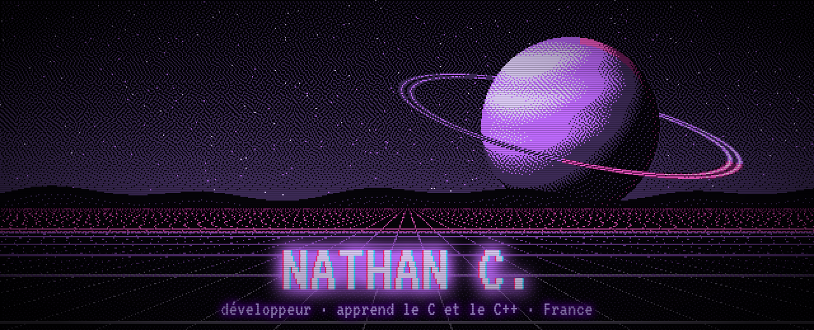
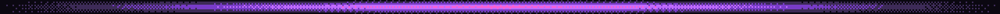
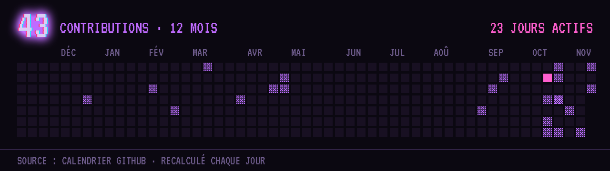
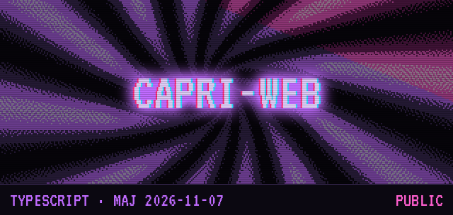
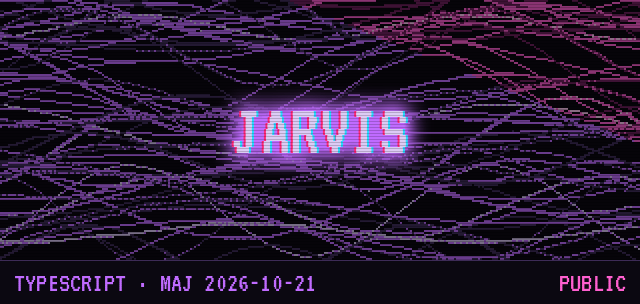
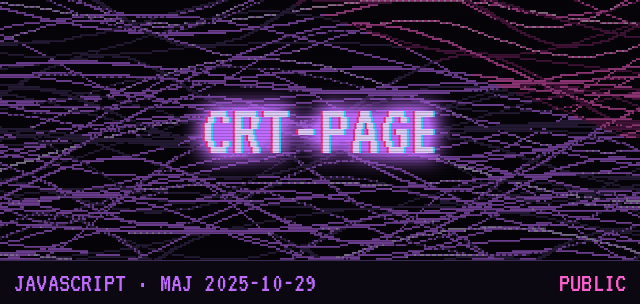
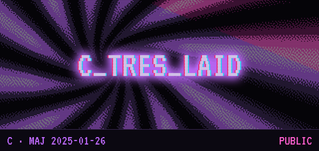
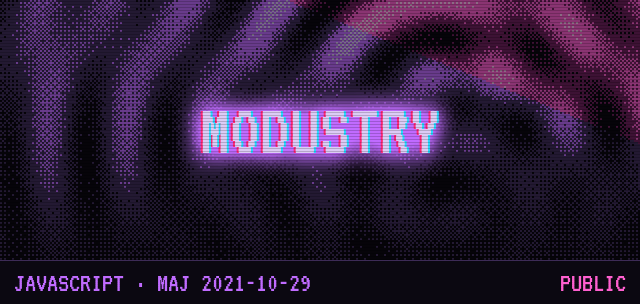
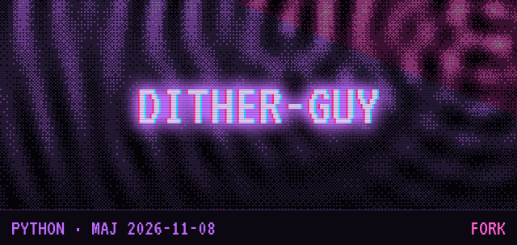
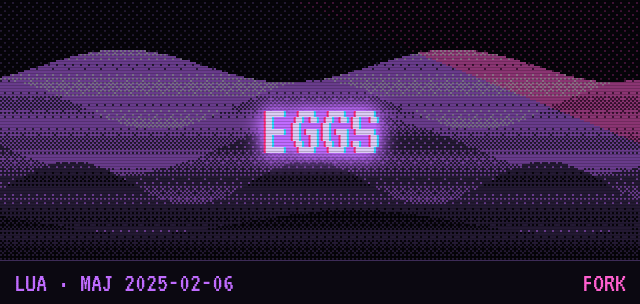

 

**J&#x27;apprends le C et le C++ (souhaitez-moi bonne chance) ; à côté, je fais du web, de l&#x27;infra auto-hébergée et des projets rétro qui clignotent.**

### [⌂ ncombes.fr](https://ncombes.fr) &nbsp;·&nbsp; [▤ Mes dépôts](https://github.com/natachaaaaa?tab=repositories)

Visuels générés par <a href="scripts/generate.py"><b>scripts/generate.py</b></a> · style emprunté au README de <a href="https://github.com/natachaaaaa/dither-guy"><b>Dither Guy</b></a> · <a href="#-crédits">crédits ↓</a>

## ◉ Activité

**43** contributions sur les douze derniers mois, réparties sur **23** jours. Recalculé chaque jour à partir du calendrier GitHub.

## ◉ Projets

<table>
<tr>
<td width="50%" valign="top"> <b><a href="https://github.com/natachaaaaa/capri-web">capri-web</a></b> Capri, la construction de personnalité d&#x27;Edgerunners 2, dans un onglet du navigateur : animée, à voix haute, avec outils MCP. Tout reste en local. TypeScript 95 % · CSS 5 % · Dockerfile 0 %</td>
<td width="50%" valign="top"> <b><a href="https://github.com/natachaaaaa/JARVIS">JARVIS</a></b> Assistant vocal façon J.A.R.V.I.S. dans le navigateur, en Next.js, pensé pour la veille sécurité : CVE et exploits du moment, en direct. TypeScript 80 % · CSS 20 %</td>
</tr>
<tr>
<td width="50%" valign="top"> <b><a href="https://github.com/natachaaaaa/crt-page">crt-page</a></b> Effet d&#x27;écran CRT rétro en JavaScript vanilla et GSAP : scanlines, scintillement, distorsion et bavure lumineuse. JavaScript 58 % · CSS 32 % · HTML 10 %</td>
<td width="50%" valign="top"> <b><a href="https://github.com/natachaaaaa/C_tres_laid">C_tres_laid</a></b> Mes entraînements en C. « C très laid », tu l&#x27;as le jeu de mots ? C 100 %</td>
</tr>
<tr>
<td width="50%" valign="top"> <b><a href="https://github.com/natachaaaaa/Modustry">Modustry</a></b> AfterNath Modustry : un multimod pour le jeu Mindustry. JavaScript 100 %</td>
</tr>
</table>

## ◉ Forks

Des projets d'autres personnes, sur lesquels j'ai travaillé. Le crédit revient d'abord à leurs auteurs.

<table>
<tr>
<td width="50%" valign="top"> <b><a href="https://github.com/natachaaaaa/dither-guy">dither-guy</a></b> d'après <a href="https://github.com/manoelpiovesan/dither-guy">manoelpiovesan/dither-guy</a> Logiciel de dithering d&#x27;images en Python, inspiré de Dither Boy. Python 100 %</td>
<td width="50%" valign="top"> <b><a href="https://github.com/natachaaaaa/eggs">eggs</a></b> d'après <a href="https://github.com/pelican-eggs/eggs">pelican-eggs/eggs</a> Service eggs for the pterodactyl panel Lua 60 % · Shell 40 %</td>
</tr>
</table>

## ◉ Stack

<table>
<tr>
<td width="50%" valign="top">
<b>Langages</b> 

</td>
<td width="50%" valign="top">
<b>Web</b> 

  
<b>Infra</b> 

</td>
</tr>
</table>

## ◉ Crédits

- **Style** : repris du README de [Dither Guy](https://github.com/natachaaaaa/dither-guy), lui-même un fork du projet de [Manoel Piovesan](https://github.com/manoelpiovesan/dither-guy), à qui revient l'idée de départ.
- **Visuels** : dessins procéduraux originaux, tramés (Atkinson et Bayer) par [`scripts/generate.py`](scripts/generate.py).
- **Police** : [VT323](https://fonts.google.com/specimen/VT323) de Peter Hull, sous [SIL Open Font License 1.1](fonts/OFL.txt).
- **Badges** : [shields.io](https://shields.io), logos [Simple Icons](https://simpleicons.org) (CC0).

Mis à jour automatiquement chaque jour par une GitHub Action.

