Développeur basé en France. En ce moment j&#x27;apprends le C et le C++ (souhaitez-moi bonne chance) ; à côté, je fais du web, un peu d&#x27;infra auto-hébergée et des projets rétro qui clignotent. <b><a href="https://ncombes.fr">ncombes.fr</a></b>

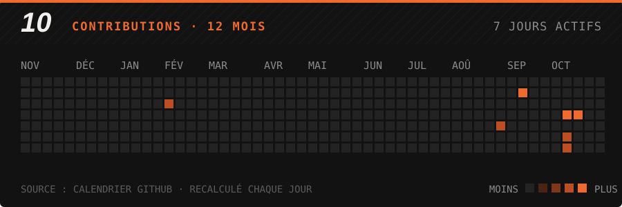

<a href="https://github.com/natachaaaaa/capri-web">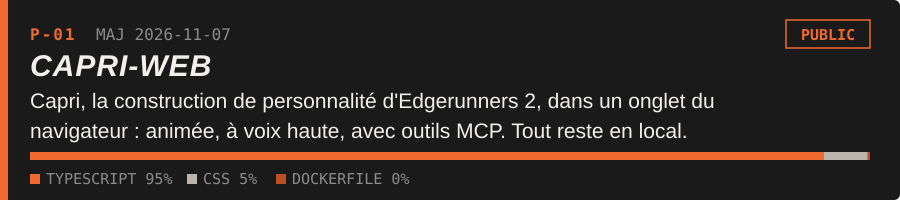</a>
<a href="https://github.com/natachaaaaa/JARVIS">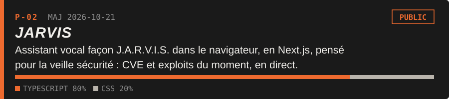</a>
<a href="https://github.com/natachaaaaa/crt-page">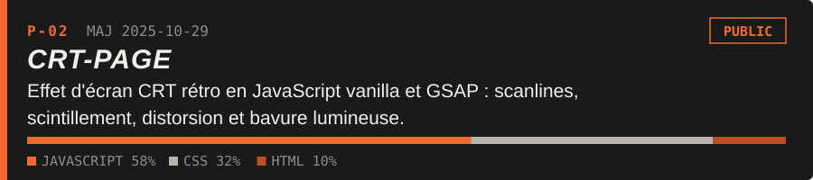</a>
<a href="https://github.com/natachaaaaa/C_tres_laid">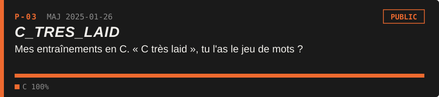</a>
<a href="https://github.com/natachaaaaa/Modustry">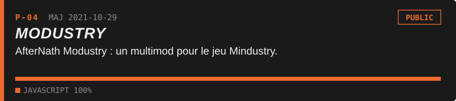</a>

<a href="https://github.com/natachaaaaa/dither-guy">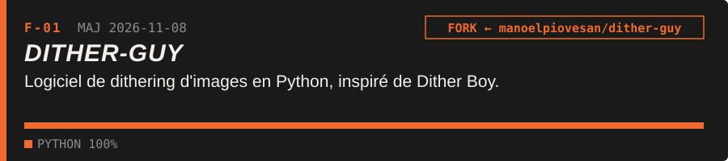</a>
<a href="https://github.com/natachaaaaa/sentinel-tickets-glpi">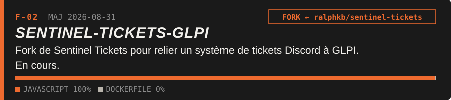</a>

 
 
 
 
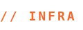 
 

 
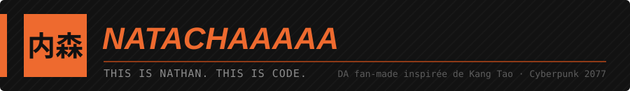
